# Freedrive Season 4 — Turbine (Jet Drive) Development

Development log for the ducted jet drive (turbine) propulsion variant of Freedrive.
Context: replace the open propeller with a ducted jet for safety, touchdown drag,
and prop-loss immunity, while keeping the light-assist power class (~2-2.7 kW).

Main thread: https://foil.zone/t/light-assist-season-3/24787
Related analysis: [research.md](../research.md)

---

## 1. Why a turbine

- **Safety**: open prop close calls accumulate with hours. A ducted jet keeps the
  impeller behind a duct lip. This is the main driver (post #351).
- **Touchdown behavior**: open pod causes high drag on touchdown. A ducted unit
  idles much cleaner when the motor spins (post #355).
- **No prop loss**: no folding mechanism, no loose blades to shed.
- **Use case**: downwind starts, surf pop-up, displacement motoring between peaks.
  Same "Flite AMP class" target, open-source and repairable.

Trade-offs accepted for v1:
- Higher static pressure loss in duct → lower efficiency than open prop at flat out.
- Air intake sensitivity (open duct top).
- Touchdown with motor OFF is still a hard brake (funnel effect).

---

## 2. Timeline

| Date | Event | Thread ref |
| :--- | :--- | :--- |
| 2025-09 | Jet concept raised for S3 ("jet pod or EDF style" for safety) | [#131963](https://foil.zone/t/24787/131963) |
| 2026-05 | 5085 motor test path started (weight reduction, see [§4](#4-the-5085-motor-path)) | [#208](https://foil.zone/t/24787/208) |
| 2026-08-17 | V4 prop pod lost in the water. Reliability rework begins. 5085 re-ordered | [#342](https://foil.zone/t/24787/342) |
| 2026-09-05 | S4 jet concept posted ("trying something new for season 4") | [#345](https://foil.zone/t/24787/345) |
| 2026-09-08 | Concept detail: angled intake to save space + reduce cavitation. 5080 motor + 4-blade prop selected | [#348](https://foil.zone/t/24787/348) |
| 2026-09-12 | Bench/early water feedback: sensitive to air intake, balance OK, no scrape/vibration | [#354](https://foil.zone/t/24787/354) |
| 2026-09-13 | **First water test success** (see [§5](#5-first-water-test--13-sept-2026)). Test videos posted | [#355](https://foil.zone/t/24787/355), [#356](https://foil.zone/t/24787/356) |
| 2026-09-17 | **Dedicated S4 system concept v1** drawn: 95 mm jet, 12S2P removable pack, in-board cartridge intake ahead of the mast | [#358](https://foil.zone/t/24787/358) |
| 2026-09-28 | Potting teardown warning: Magic Gel dissolved the silicone thermal pad | [#361](https://foil.zone/t/24787/361) |
| 2026-10-13 | **Scaling decision**: RC boat 40 mm turbine files bought, scaled to 50 mm. New package layout: motor under the mast, side inlets, battery in front | [#369](https://foil.zone/t/24787/369) |
| 2026-10-17 | Season board test: high aspect 980 cm² foil will not start the sinker board. Conclusion: big wing area for learning | [#372](https://foil.zone/t/24787/372) |
| 2026-10-18 | Turbine CAD progress posted: two-stage nacelle, section view. Drag discussion with @Jan12 | [#373](https://foil.zone/t/24787/373) |
| 2026-10-27 | **Motor and shaft ordered**: 5065 320 KV (1800 W rated), 8 mm stainless shaft. CAD paused meanwhile | [#377](https://foil.zone/t/24787/377) |

---

## 3. Test unit (S4 jet v1)

| Item | Spec |
| :--- | :--- |
| Motor | 5080, 4-blade prop supplied, ~95 mm pitch (low pitch per [@V_S](https://foil.zone/t/24787/353)) |
| Intake | Angled duct entry (space saving + cavitation reduction) |
| Battery | 12S1P 21700 P45B, 199 Wh |
| ESC | BWESC 80 V 220 A |
| Max draw seen | 41 V / 65 A ≈ **2.66 kW** |
| Mount | High on the mast, higher than the usual V4 pod |
| Weight | ~1.5–2 kg (pod + motor + prop) |

Concept and build photos (from the thread):

| Concept sketch | Intake detail | Angled 5080 + 4-blade prop | Wiring |
| :--- | :--- | :--- | :--- |
| 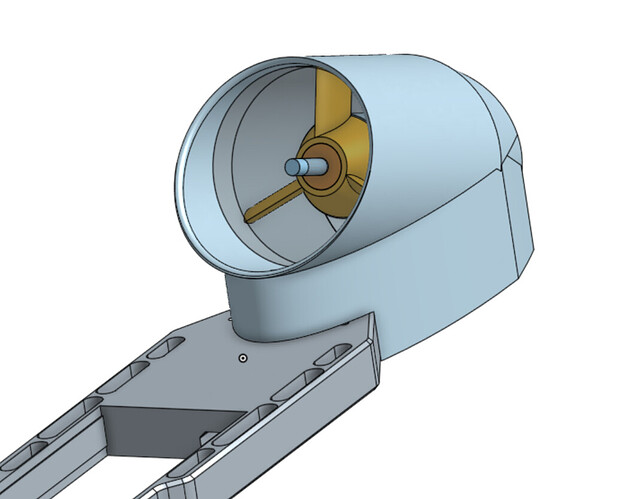 | 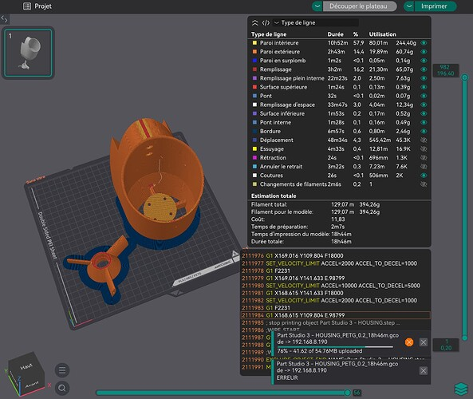 | 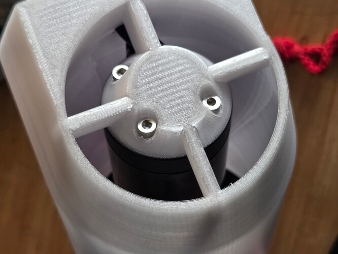 | 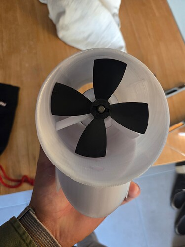 |

---

## 4. The 5085 motor path (context)

The turbine work follows directly from the 5085 motor swap, which cut ~400 g from
the V4 prop setup and gave the cleanest feel of all tested motors.

- **2026-05-12** — 5085 ordered (same motor as @foilstate's proven design).
- **2026-05-13** — V4 pod hacked to fit the 5085. Hub printed (PETG-GF cracked
  after one session → PPA/PA 100% infill hubs).
- **2026-05-16** — First 5085 test with unbalanced carbon prop + cotter pins:
  felt stronger than the maytech 6374, lower drag on pod touchdown, easy
  starts in small chop. (post [#220](https://foil.zone/t/24787/220))
- **2026-06-06** — Titanium blade set received (90 USD, alu + ti set). No post
  processing needed, edges sharper than alu. (post [#256](https://foil.zone/t/24787/256))
- **2026-06-15** — Ti prop test: perfect out of the box. 5085 + ti setup "very
  smooth, gets forgotten when pumping". Previous DW score passed on 15 kt
  tailwind + slow Saône current. Ti bolts + ti blades credited. (post [#261](https://foil.zone/t/24787/261))

5085 / Ti build photos:

| Hacked 5085 pod | First 5085 water test | Ti blade set |
| :--- | :--- | :--- |
| 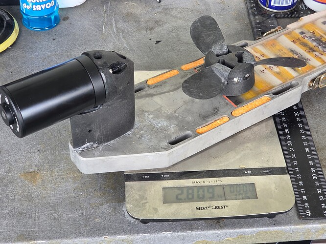 | 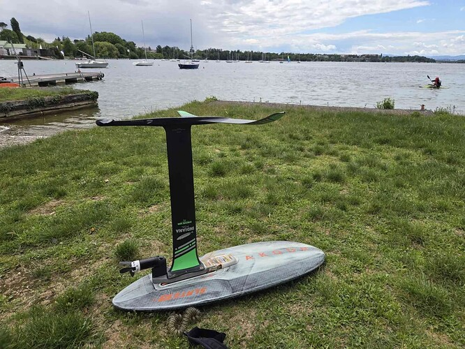 | 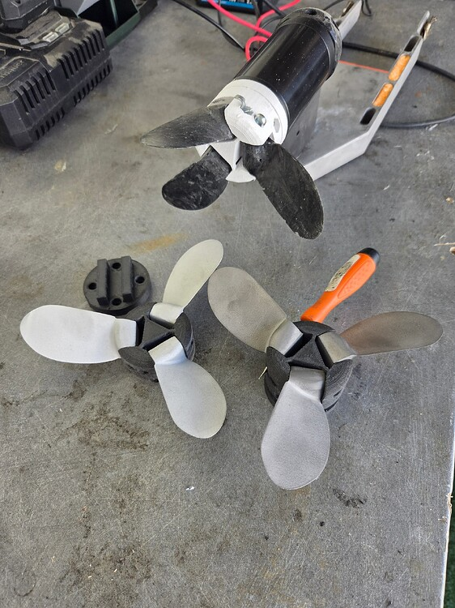 |

---

## 5. First water test — 13 Sept 2026

Results from the first dedicated jet test (post [#355](https://foil.zone/t/24787/355)):

- **System works.** Small board started a few times, but only with full battery.
- **Battery hammered**: 41 V / 65 A at full charge on 12S1P. 199 Wh is too small
  for this duty cycle. 12S2P is the fix.
- **Big board**: easy flying with some pumping. Transition to fully flying not easy.
- **Touchdown**: motor off = lot of drag (funnel brake). Motor spinning = drag much less noticeable.
- **Air intake**: confirmed very sensitive (post #354).
- **Balance**: no scraping or vibration felt.

Test screenshots (from the posted videos, [13 septembre 2026](https://www.youtube.com/watch?v=aBwcKk_be1A) and [End of battery](https://www.youtube.com/watch?v=OXS7Xq_WdP4)):

| Start on small board | Foiling with the jet | Flight, big board |
| :--- | :--- | :--- |
|  |  |  |

On-site photos from the test day (post #355):

| Jet test 1 | Jet test 2 |
| :--- | :--- |
| 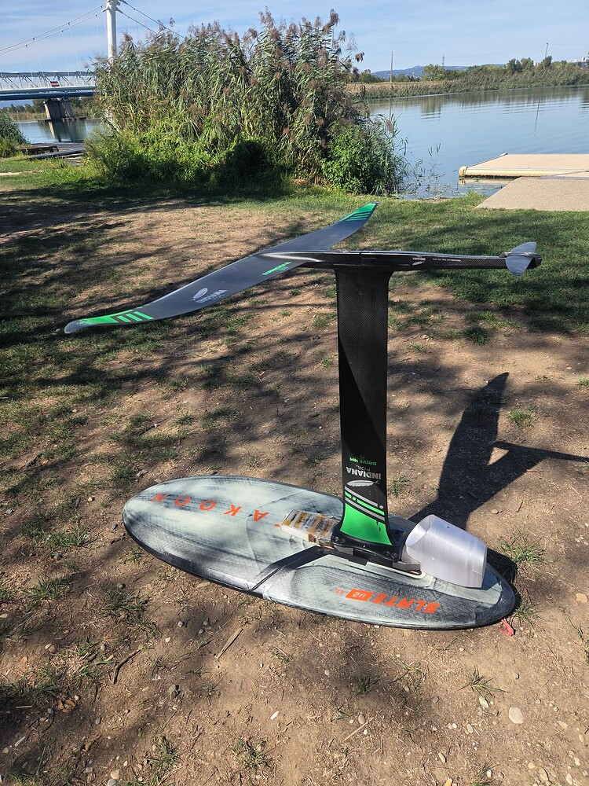 | 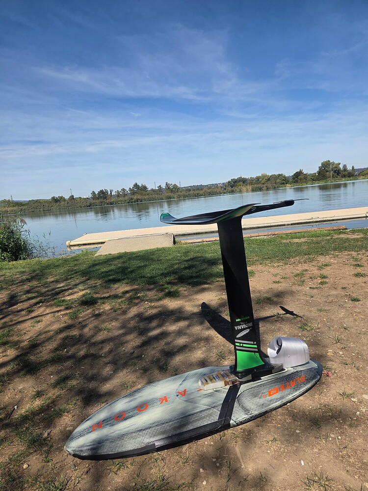 |

---

## 6. Known gaps (carried from research.md, updated by the tests)

1. **Prop pitch**: 95 mm too low for DW speed. Higher pitch impeller next.
2. **Air intake**: sensitive → shroud or redesigned intake.
3. **Touchdown drag**: motor-off funnel brake → gate or folding element study.
4. **Thermal**: 5080 at 65 A sustained, no active cooling → monitor.
5. **Pod retention**: pod lost in water (17 Aug 2026) → retention mechanism.
6. **Battery**: 199 Wh too small for 2.66 kW → 12S2P (398 Wh) or 16S1P.
7. **Motor rating vs power target**: the 5065 320 KV bought on 27 Oct is rated 1800 W.
   The 50 mm jet needs 2.2-2.7 kW. This must be settled before the first bench run.
8. **Thrust expectation**: a 50 mm jet at this power class is a 15-18 kg unit, not 25 kg.
   Size the foil and board to that number. See [research.md §8](../research.md#8-scaling-law-for-the-jet-unit).

---

## 7. Design v2: dedicated S4 unit (17 Sept 2026)

Concept v1 for a clean S4 build, posted in [#358](https://foil.zone/t/24787/358).
This was still built around a 5080-scale 95 mm jet.

| Item | v1 decision |
| :--- | :--- |
| Jet | 5080 motor, **95 mm** impeller (same scale as the test unit) |
| Battery | **12S2P** removable 21700 pack, sealed for travel |
| Battery fill | Travel fill: 21700 cells + wires pushed in from one side, one **4S1P** module with BMS on top, then close |
| Intake | **In-board cartridge** in front of the mast. Water enters in front, the cartridge turns it 90°, the motor sits behind the mast |
| Board | Dual plywood stringers, or a carbon tube. Electronics sit on top of the stringers |
| Reason | Keeps the parawing option: no deep trench under the mast |

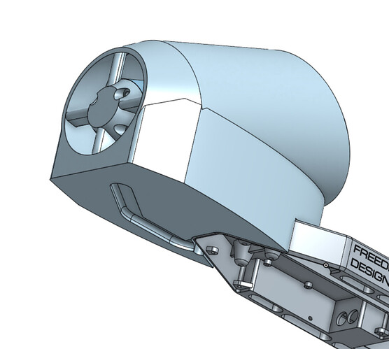

Design driver that changed later: a 95 mm jet forces a thick board section. The
50 mm path in [§8](#8-design-v3-scaled-50-mm-two-stage-turbine-oct-2026) fixes that.

---

## 8. Design v3: scaled 50 mm two-stage turbine (Oct 2026)

### Where it came from
Files for an **RC boat 40 mm turbine** were bought on 13 Oct ([#369](https://foil.zone/t/24787/369)).
That builder reports **13.3 kg thrust for about 8 s at 8S / 2.2 kW**. The plan is to scale
the same geometry to **50 mm** and design a full board around it.

### Package layout
- **Motor under the mast.** Water enters through the board, so the motor does not
  have to sit in the flow.
- **One water inlet on each side** of the unit. This keeps the intake below the
  surface and attacks the air ingestion problem from [§5](#5-first-water-test--13-sept-2026).
- **Battery in front** of the unit.
- **Package thickness about 55 mm.** The 40 mm parts scale to 50 mm, so the whole
  unit fits in a 55 mm board cavity.
- Impeller diameter under study: **50-55 mm**.

### Why two stages
Per [@BabePilot](https://foil.zone/t/24787/376) and the Flite AMP thread: stage one
pushes water, stage two pushes the air-water mix. That makes the unit far less
sensitive to air ingestion. It also matches the "not much cavitation" comment in the
Flite AMP review quoted in that post.

### CAD state (18 Oct, [#373](https://foil.zone/t/24787/373))
Section view of the nacelle: two bladed stages, a centre cone between them, and a
converging exit. A hexagonal circle array sits alongside, in the layout of a 21700 cell pack.

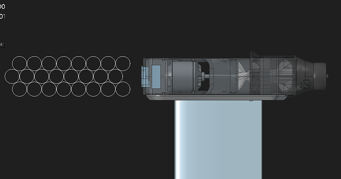
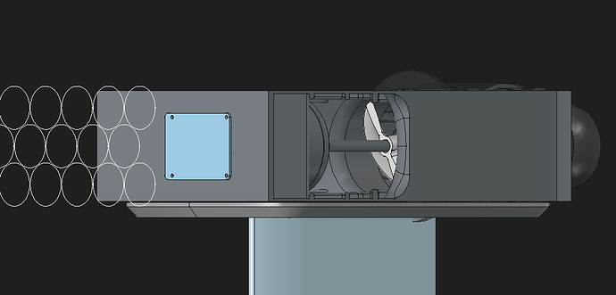

Earlier layout work (11-13 Oct, [#369](https://foil.zone/t/24787/369)):

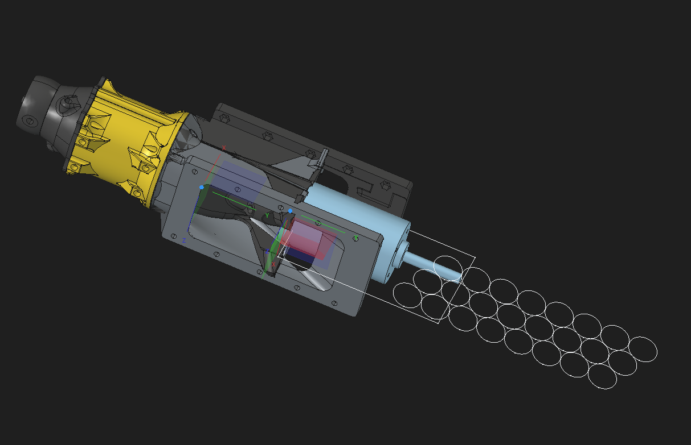
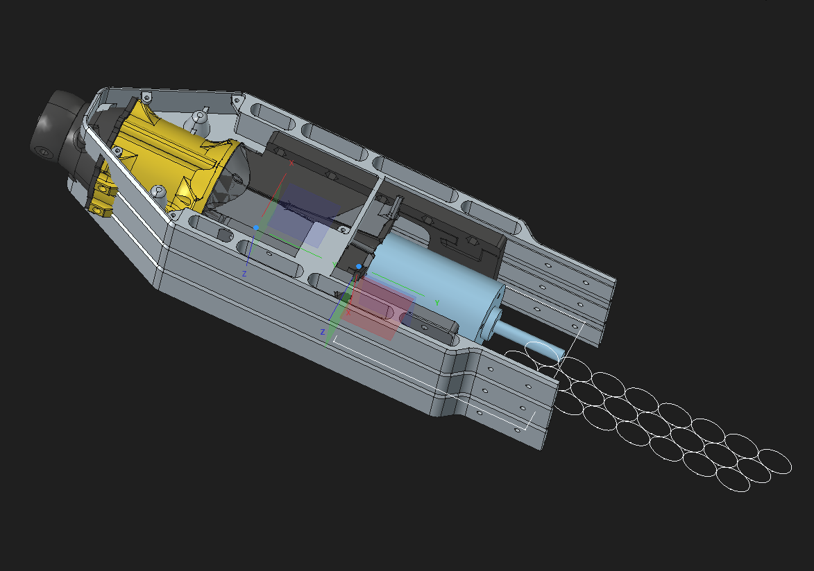

### Thrust you can expect
The scaling math is in [research.md §8](../research.md#8-scaling-law-for-the-jet-unit).
Short version, for the same geometry family: **thrust scales with (power × diameter)^(2/3)**.

| Impeller | Power | Expected thrust |
| :--- | :--- | :--- |
| 40 mm | 2.2 kW | 13.3 kg (builder report) |
| 50 mm | 2.2 kW | 15 kg |
| 50 mm | 2.7 kW | 18 kg |
| 60 mm | 2.7 kW | 20 kg |
| 80 mm (5080 test unit) | 2.7 kW | 24 kg (measured about 25 kg) |

A 50 mm unit will not match the 80 mm test unit. It trades about 6 kg of thrust for
a 55 mm board cavity and no open prop.

---

## 9. Build hardware (27 Oct 2026)

From [#377](https://foil.zone/t/24787/377):

| Item | Part |
| :--- | :--- |
| Motor | **5065, 320 KV, rated 1800 W** |
| Shaft | **8 mm stainless steel** |

No-load speed at 12S: 13,100 rpm at 41 V, 16,100 rpm at 50.4 V. That is enough
rpm for a 50 mm impeller without gearing. Tip speed reaches 42 m/s at full charge
with a 50 mm impeller, which is near the cavitation limit in water.

Two checks before the motor goes in:
1. The 1800 W rating is lower than the 2.2-2.7 kW the board pulls. Confirm the real
   continuous rating with a bench run before committing the housing to this motor.
2. Water cooling for the 5065 must be designed in. The 5080 test unit ran without it.

One part from the bought file set, as posted in #373. The model carries the author
tag "HarryMLawson 220":

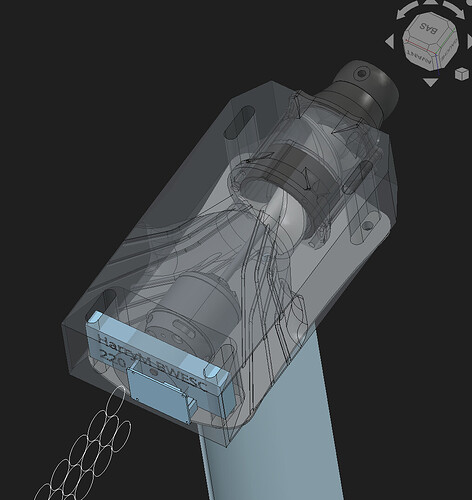

Turbine CAD is on hold while these parts arrive.

---

## 10. Design discussion carried from the thread

- **Why not simply copy the Flite AMP layout?** @Jan12 argues the AMP sits under the
  mast and in front of the rider, so it has little added drag and does not hurt
  pop-up ([#374](https://foil.zone/t/24787/374)). A mast-mounted jet adds more drag
  and is worse for pop-up.
- **Answer on record** ([#375](https://foil.zone/t/24787/375)): the AMP is also
  mast-assisted in effect, the duct is short, and the enclosed design copes with
  cavitation. A ducted unit also protects the rider from the blades, which stays the
  main reason for this path.
- **Open item**: quantify the drag difference. A towing test or a coast-down run
  with the jet idle versus off would settle it. This is not done.
- **Foil sizing lesson** ([#372](https://foil.zone/t/24787/372)): a high aspect
  980 cm² foil will not start the new board even at 60 A, because the board sinks
  and needs lots of volume. Low aspect, high area wings are better for learning
  starts. That matches the goal of a foil usable without assist.

Ride photos from that day:

| Sinker board ride | Upwind angles | Test session, 17 Oct |
| :--- | :--- | :--- |
| 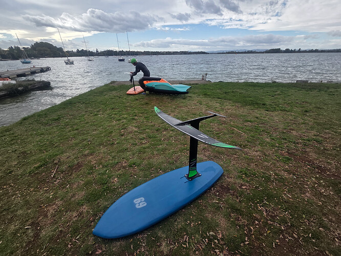 | 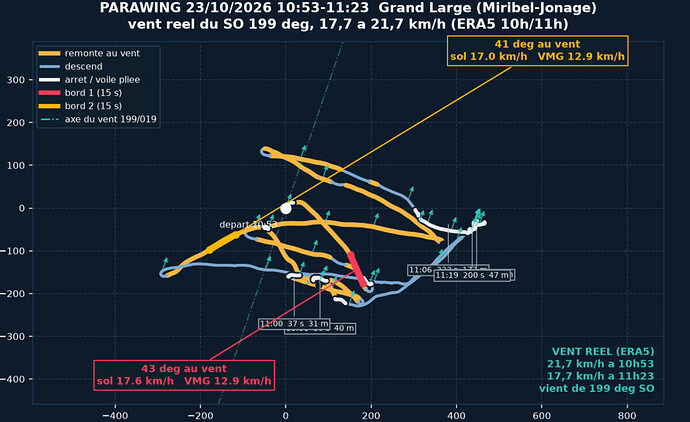 | 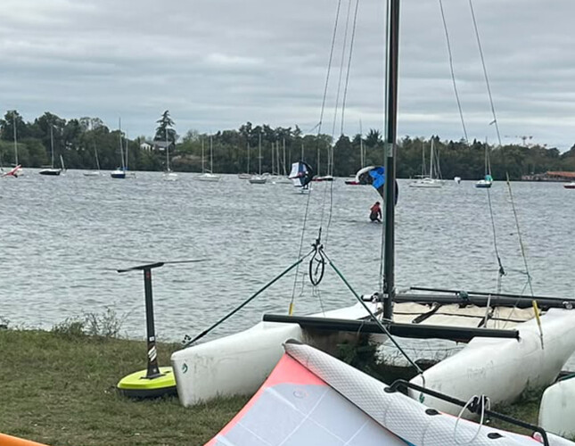 |

---

## 11. Links

- S4 jet concept: https://foil.zone/t/light-assist-season-3/24787/345
- Angled intake + motor: https://foil.zone/t/light-assist-season-3/24787/348
- Air intake sensitivity: https://foil.zone/t/light-assist-season-3/24787/354
- First water test: https://foil.zone/t/light-assist-season-3/24787/355
- Test videos: https://foil.zone/t/light-assist-season-3/24787/356
  - [13 septembre 2026](https://www.youtube.com/watch?v=aBwcKk_be1A)
  - [End of battery](https://www.youtube.com/watch?v=OXS7Xq_WdP4)
- 5085 motor: https://foil.zone/t/light-assist-season-3/24787/208
- Ti blades: https://foil.zone/t/light-assist-season-3/24787/256
- Ti prop test: https://foil.zone/t/light-assist-season-3/24787/261
- Dedicated S4 system concept (17 Sept): https://foil.zone/t/light-assist-season-3/24787/358
- 40 mm RC turbine files, 50 mm scaling (13 Oct): https://foil.zone/t/light-assist-season-3/24787/369
- Turbine CAD progress (18 Oct): https://foil.zone/t/light-assist-season-3/24787/373
- Drag / pop-up discussion: https://foil.zone/t/light-assist-season-3/24787/374
- Two-stage cavitation point: https://foil.zone/t/light-assist-season-3/24787/376
- Board and foil test (17 Oct): https://foil.zone/t/light-assist-season-3/24787/372
- Motor and shaft ordered (27 Oct): https://foil.zone/t/light-assist-season-3/24787/377
- Jet research, scaling law, field intel: [research.md](../research.md)
